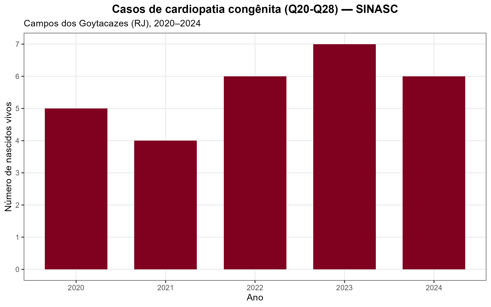
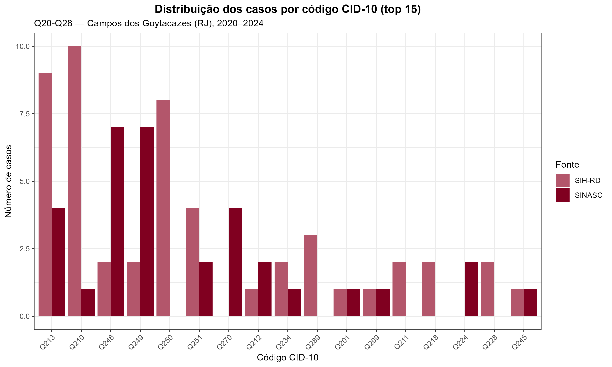
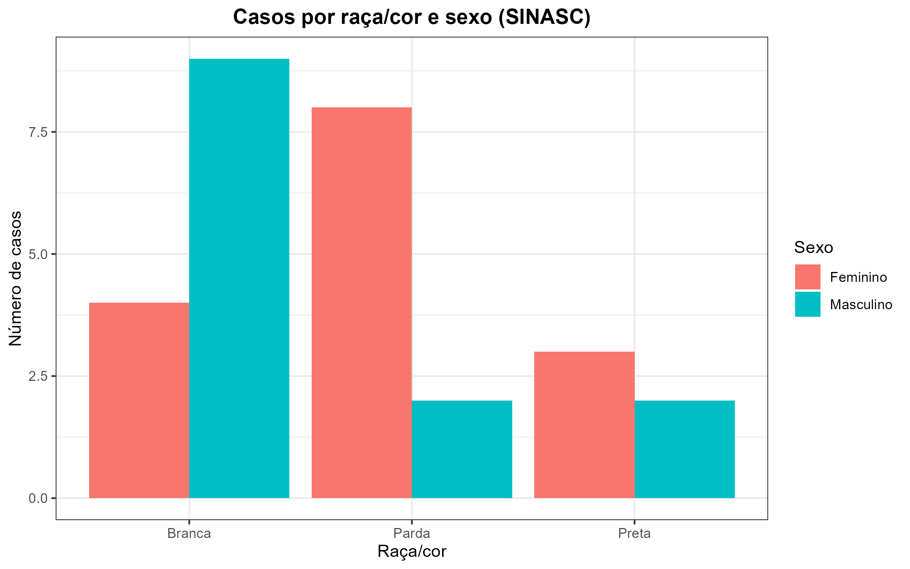
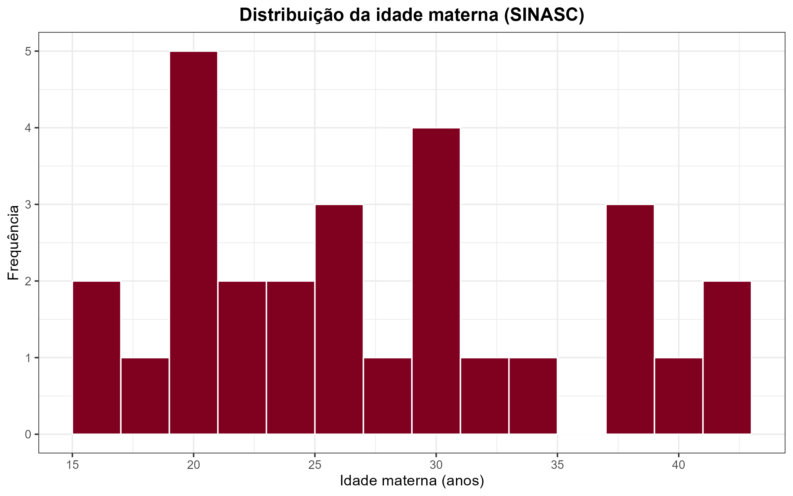
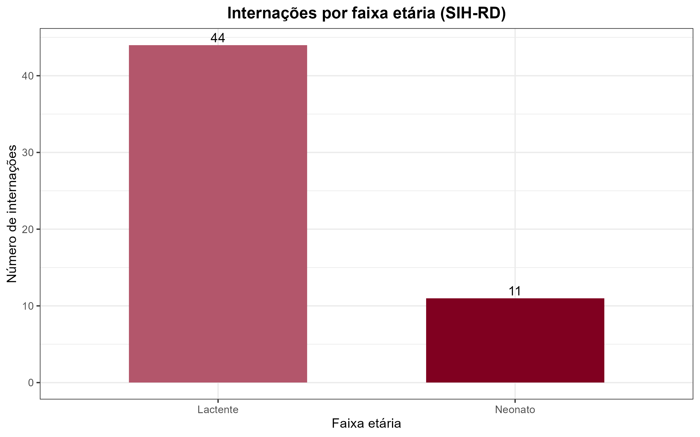
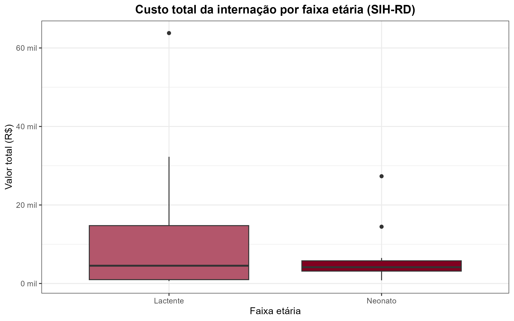
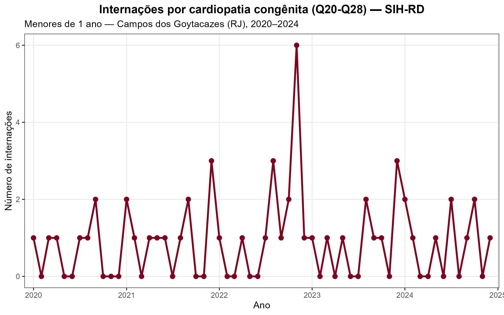

# Cardiopatias Congênitas e Adquiridas

Análise de **cardiopatias congênitas (CID-10 Q20–Q28)** em nascidos vivos e em
internações hospitalares de menores de um ano, residentes em
**Campos dos Goytacazes (RJ)**, no período de **2020 a 2024**.

**Autora:** Letícia Maria Santos
**Orientadora:** Francielly da Silva Santos Moreira

Projeto desenvolvido como Trabalho de Conclusão de Curso (TCC).

> **Repositório oficial:** https://github.com/leticiamariasantos/congenital-and-acquired-heart-diseases

---

## Descrição

O estudo utiliza dados públicos do **DATASUS** — **SINASC** (Sistema de
Informações sobre Nascidos Vivos) e **SIH-RD** (Sistema de Informações
Hospitalares, reduzida) — obtidos por meio do pacote R
[`microdatasus`](https://github.com/rfsaldanha/microdatasus), além de dados
meteorológicos do **INMET** (estação A607 — Campos dos Goytacazes).

São extraídos os registros com:

- **SINASC:** nascidos vivos com **qualquer** código CID-10 **Q20–Q28**
  (malformações congênitas do aparelho circulatório), cuja mãe reside em
  Campos dos Goytacazes (`CODMUNRES = 330100`).
- **SIH-RD:** internações de **menores de 1 ano** com diagnóstico principal
  **Q20–Q28**, residentes em Campos dos Goytacazes (`MUNIC_RES = 330100`).

> ⚠️ **Escopo atual:** a extração cobre apenas as cardiopatias **congênitas**
> (Q20–Q28). A inclusão de cardiopatias **adquiridas** (ex.: CID I00–I99) é
> uma etapa futura do trabalho.

---

## Objetivos

1. Estimar a frequência de cardiopatias congênitas (Q20–Q28) em nascidos vivos
   e internações de menores de um ano em Campos dos Goytacazes (2020–2024).
2. Descrever o perfil sociodemográfico e clínico dos casos.
3. Fornecer um pipeline **reprodutível**, **portátil** e **auditável** de
   extração e processamento dos microdados do DATASUS.

---

## Principais resultados

### Casos por ano

| Ano | Nascidos vivos Q20–Q28 (SINASC) | Internações Q20–Q28 < 1 ano (SIH-RD) |
|-----|----------------------------------|---------------------------------------|
| 2020 | 5 | 7 |
| 2021 | 4 | 12 |
| 2022 | 6 | 16 |
| 2023 | 7 | 10 |
| 2024 | 6 | 10 |
| **Total** | **28** | **55** |



### Distribuição por código CID-10 (Q20–Q28)

| CID-10 | SINASC | SIH-RD | Total |
|--------|--------|--------|-------|
| Q213 (defeitos do septo ventricular) | 4 | 9 | 13 |
| Q210 (defeitos do septo atrial) | 1 | 10 | 11 |
| Q248 (outras malformações cardíacas) | 7 | 2 | 9 |
| Q249 (malformação cardíaca não especificada) | 7 | 2 | 9 |
| Q250 (permeabilidade do canal arterial) | 0 | 8 | 8 |
| Q251 (coarctação da aorta) | 2 | 4 | 6 |
| Q270 (síndromes arteriais congênitas) | 4 | 0 | 4 |
| Demais códigos | 3 | 20 | 23 |

> A tabela completa está em [`results/resumo_cid_q20_q28.csv`](results/resumo_cid_q20_q28.csv).



### Perfil dos casos — SINASC (nascidos vivos)

| Sexo | Branca | Parda | Preta | Total |
|------|--------|-------|-------|-------|
| Feminino | 4 | 8 | 3 | 15 |
| Masculino | 9 | 2 | 2 | 13 |
| **Total** | **13** | **10** | **5** | **28** |





### Perfil das internações — SIH-RD (menores de 1 ano)

| Indicador | Valor |
|-----------|-------|
| Total de internações | 55 |
| Neonatos (0–28 dias) | 11 |
| Lactentes (29–364 dias) | 44 |
| Sexo feminino / masculino | 25 / 30 |
| Óbitos | 5 |
| Custo mediano por internação | R$ 4.519,02 |
| Custo total | R$ 517.580,70 |
| Permanência mediana | 14 dias |







> Todos os valores são reproduzíveis por
> [`analysis/01_analise_exploratoria.R`](analysis/01_analise_exploratoria.R) e
> pelas tabelas em `results/resumo_*.csv`.

---

## Estrutura do repositório

```
.
├── analysis/                 # Scripts de análise (figuras e tabelas)
│   └── 01_analise_exploratoria.R
├── data/
│   ├── raw/inmet/            # Dados meteorológicos INMET (2020–2024)
│   ├── processed/            # Tabelas finais extraídas (.rds)
│   ├── cache/                # Caches DATASUS (NÃO versionado)
│   └── README.md
├── docs/
│   ├── AUDITORIA.md          # Relatório de auditoria do código
│   └── METODOLOGIA.md        # Critérios, thresholds e benchmarks
├── results/
│   ├── auditoria/            # CSVs/JSONs de auditoria e metadados
│   ├── figures/              # Figuras geradas
│   └── *.csv                 # Tabelas finais e resumos
├── src/                      # Código-fonte (pipeline)
│   ├── 00_config.R           # Configurações e caminhos
│   ├── 01_utils.R            # Funções utilitárias
│   ├── 02_download.R         # Download DATASUS com cache/retry
│   ├── 03_process_sinasc.R   # Pipeline SINASC
│   ├── 04_process_sih.R      # Pipeline SIH-RD
│   ├── run_sinasc.R          # Executa o pipeline SINASC
│   └── run_sih.R             # Executa o pipeline SIH-RD
├── tests/
│   └── test_utils.R          # Testes das funções utilitárias
├── .gitignore                # Arquivos/pastas ignorados pelo Git
├── .gitattributes            # Normalização de fim de linha e binários
├── LICENSE                   # MIT
├── README.en.md              # Resumo em inglês
├── README.md
└── requirements.R            # Instalação de dependências
```

---

## Instalação e execução

### Pré-requisitos

- [R](https://cran.r-project.org/) ≥ 4.1 (testado em R 4.5.3).
- Acesso à internet (apenas para o **primeiro** download do DATASUS; depois os
  caches locais são reutilizados).

### 1. Instalar dependências

```r
# a partir da raiz do repositório
source("requirements.R")
# ou: Rscript requirements.R
```

### 2. Executar a extração

```r
Rscript src/run_sinasc.R   # extrai casos Q20–Q28 do SINASC
Rscript src/run_sih.R      # extrai internações Q20–Q28 (< 1 ano) do SIH-RD
```

Os scripts:

- baixam os microdados do DATASUS (com retry e cache em `data/cache/`);
- aplicam os critérios de inclusão;
- geram as tabelas finais (`data/processed/*.rds` e `results/*.csv`);
- geram arquivos de auditoria e metadados (`results/auditoria/`).

### 3. Executar a análise exploratória

```r
Rscript analysis/01_analise_exploratoria.R
```

Gera as figuras em `results/figures/` e as tabelas de resumo em `results/`.

### 4. Rodar os testes

```r
Rscript tests/test_utils.R
```

---

## Reproducibilidade

- **Caminhos relativos** à raiz do repositório (sem caminhos absolutos).
- **Cache local** de downloads (`data/cache/`, ignorado pelo Git), que evita
  novos downloads e garante os mesmos insumos.
- **Metadados de execução** com versões de pacotes, versão do R, `sessionInfo()`
  e **hashes SHA-256** dos arquivos gerados (`results/auditoria/`).
- **Trilha de auditoria** por linha: `audit_row_id`, `audit_hash_linha` e
  colunas `audit_*` que registram cada critério de inclusão.
- **Testes automatizados** (`tests/test_utils.R`) para as funções críticas.
- **Semente fixa** quando houver aleatoriedade (não há nas etapas atuais).

## Portabilidade

- Código em **R puro** (sem dependências de caminhos do sistema ou de serviços
  externos além do DATASUS).
- **UTF-8** em todos os arquivos; `.gitattributes` normaliza fim de linha.
- Compatível com **Windows/macOS/Linux** (testado em Windows 11 x64).
- Para **reprodutibilidade de longo prazo**, recomenda-se travar as versões dos
  pacotes com [`renv`](https://rstudio.github.io/renv/):
  ```r
  renv::init()
  renv::snapshot()
  ```

## Conformidade (compliance)

- **Privacidade (LGPD):** as colunas do SIH-RD com dados pessoais ou
  identificadores únicos (`CPF_AUT`, `GESTOR_CPF`, `GESTOR_DT`, `IDENT`,
  `N_AIH`) são **removidas no pipeline** antes da publicação
  (`CONFIG$colunas_sensiveis_sih`). Não são publicados CPF, CNES de pessoa
  física ou identificadores de paciente.
- **Declaração de uso de IA:** conforme **Portaria CNPq nº 2.664/2026**
  (ver seção abaixo).
- **Licença de código:** MIT License (ver [LICENSE](LICENSE)).
- **Dados:** DATASUS e INMET são fontes públicas; verifique os termos de uso de
  cada fonte antes de redistribuição.

## Transparência

- **Código aberto** e versionado (histórico completo no GitHub).
- **Dados e metadados abertos** em `results/` (CSVs) e `results/auditoria/`
  (JSON com critérios, versões e hashes).
- **Critérios de inclusão e thresholds documentados** em
  [`docs/METODOLOGIA.md`](docs/METODOLOGIA.md).
- **Relatório de auditoria** completo em [`docs/AUDITORIA.md`](docs/AUDITORIA.md),
  incluindo bugs corrigidos e impacto nos resultados.

---

## Declaração de uso de Inteligência Artificial Generativa (Portaria CNPq nº 2.664/2026)

Em conformidade com a **Portaria CNPq nº 2.664, de 6 de março de 2026**, que
institui a Política de Integridade na Atividade Científica do CNPq, e, em
especial, com o **art. 9º, inciso I, alíneas "c" e "d"** — que determinam
*"declarar o uso de ferramentas de Inteligência Artificial Generativa (IAG),
de qualquer espécie e em qualquer fase do desenvolvimento da pesquisa
(concepção, redação, análise de dados, submissão), especificando nos
respectivos textos e exposições eletrônicas a ferramenta utilizada e a
finalidade"* e que *"é vedada a submissão de conteúdo gerado por IAG como se
fosse de autoria humana, sendo os autores integralmente responsáveis pelo
conteúdo final"* —, declaramos:

### Ferramenta utilizada

| Ferramenta (IAG) | Modelo | Fornecedor |
|------------------|--------|------------|
| DeepSeek — assistente de programação e edição de texto | **deepseek-v4-pro** | DeepSeek |

### Finalidade e etapas de uso

A ferramenta de IAG **deepseek-v4-pro** foi utilizada **exclusivamente como
apoio técnico** de programação e edição de texto, nas seguintes etapas e
finalidades:

1. **Refatoração dos scripts de auditoria** — revisão e reescrita dos scripts
   de extração e processamento (`src/`), da trilha de auditoria por linha
   (`audit_row_id`, `audit_hash_linha` e colunas `audit_*`) e da geração dos
   arquivos de auditoria e metadados (`results/auditoria/`), conforme
   relatado em [`docs/AUDITORIA.md`](docs/AUDITORIA.md).
2. **Auditoria e correção de código** — identificação e correção de bugs
   (ex.: ancoragem incorreta do CID Q20–Q28, fallback inoperante de
   `COD_IDADE`, normalização de `CID`), com impacto documentado nos
   resultados (22 → 28 casos SINASC recuperados).
3. **Documentação** — elaboração de `README.md`, `docs/AUDITORIA.md` e
   `docs/METODOLOGIA.md`.
4. **Elaboração de tabelas, gráficos e textos de suporte** na análise
   exploratória.

### Limites e responsabilidades

1. **Nenhum dado foi gerado por IA.** Todos os dados analisados provêm de
   fontes públicas (DATASUS e INMET) e foram processados por código aberto e
   verificável, sem uso de IAG para fabricação, falsificação ou manipulação de
   dados.
2. **Nenhum conteúdo gerado por IAG foi submetido como se fosse de autoria
   humana** (art. 9º, I, "d"). Todo texto e código produzidos com apoio da
   ferramenta foram revisados, validados e ajustados pelas autoras.
3. A **interpretação científica**, a **definição metodológica**, a **validação
   dos resultados** e a **revisão crítica** são de responsabilidade exclusiva
   da autora e da orientadora.
4. As autoras são **integralmente responsáveis pelo conteúdo final**,
   inclusive por eventuais plágios ou imprecisões geradas pela IAG, tendo os
   resultados apresentados sido **revisados e validados manualmente** antes da
   publicação.

---

## Contribuições (CRediT)

*Contributor Roles Taxonomy* — papéis de autoria:

| Papel (CRediT) | Letícia Maria Santos | Francielly da Silva Santos Moreira |
|----------------|:---:|:---:|
| Conceituação | ✓ | ✓ |
| Curadoria de dados | ✓ | |
| Análise formal | ✓ | |
| Aquisição de financiamento | | |
| Investigação | ✓ | |
| Metodologia | ✓ | ✓ |
| Administração do projeto | | ✓ |
| Recursos | ✓ | |
| Software | ✓ | |
| Supervisão | | ✓ |
| Validação | ✓ | ✓ |
| Visualização | ✓ | |
| Escrita – rascunho original | ✓ | |
| Escrita – revisão e edição | ✓ | ✓ |

---

## Fontes de dados

- **SINASC / SIH-RD** — DATASUS (Ministério da Saúde), via
  [`microdatasus`](https://github.com/rfsaldanha/microdatasus).
- **INMET** — Estação A607 (Campos dos Goytacazes), dados meteorológicos
  horários 2020–2024.

---

## Como citar

> Santos, L. M.; Moreira, F. S. S. (orient.). *Cardiopatias Congênitas e
> Adquiridas*. Trabalho de Conclusão de Curso. Repositório:
> https://github.com/leticiamariasantos/congenital-and-acquired-heart-diseases

Formato BibTeX:

```bibtex
@misc{santos_cardiopatias,
  author       = {Santos, Letícia Maria},
  title        = {Cardiopatias Congênitas e Adquiridas},
  year         = {2026},
  note         = {Orientadora: Francielly da Silva Santos Moreira. Trabalho de Conclusão de Curso},
  howpublished = {\url{https://github.com/leticiamariasantos/congenital-and-acquired-heart-diseases}}
}
```

---

## Licença

Este projeto está licenciado sob a **MIT License** — veja [LICENSE](LICENSE).

Os dados do DATASUS e do INMET são públicos; verifique os termos de uso de cada
fonte antes de redistribuição.
